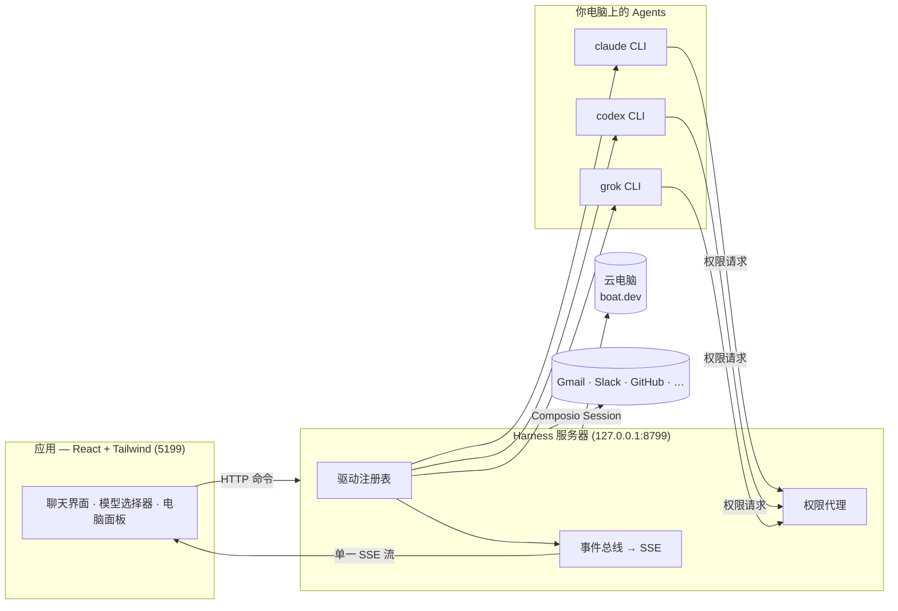

<div align="center">

# OpenMausBot

**开源的 Grok Bot 替代品：你自己的 AI 机器人团队，就在一个聊天应用里。**

**简体中文** &nbsp;·&nbsp; [English](README.md)

[**openmausbot.com**](https://www.openmausbot.com) &nbsp;·&nbsp; [下载](https://www.openmausbot.com/download) &nbsp;·&nbsp; [开源 Grok Bot 替代品对比](https://www.openmausbot.com/blog/grok-bot-vs-openmausbot)

<sub>OpenMausBot 是开源的 Grok Bot 替代品：一个受 **Grok Bot** 启发的独立项目，同时也是 **Meta Muse**、**OpenAI dots** 和 **Cue by Manus** 的开源替代方案——自带 Agent（bring-your-own-agent）、本地优先、跑在你已有的模型上。又名 **MausBot**，曾用名 **OpenGrokBot**。与 xAI、Meta、OpenAI、Manus 均无关联。</sub>

侧边栏里的每一个机器人都是一个真实的 agent——底层是在你本机运行的 Claude 或 Codex——它有自己的人格、自己的模型、自己的云电脑、自己的已连接应用。
像对待联系人一样和它们聊天。看着它们干活。只批准真正重要的事。


[](https://github.com/milind-soni/OpenMausBot/releases/latest)


<br>

<a href="https://github.com/milind-soni/OpenMausBot/releases/latest/download/OpenMausBot.dmg">
  
</a>
&nbsp;
<a href="https://github.com/milind-soni/OpenMausBot/releases/latest/download/OpenMausBot-intel.dmg">
  
</a>
&nbsp;
<a href="https://github.com/milind-soni/OpenMausBot/releases/latest/download/OpenMausBot-setup.exe">
  
</a>
&nbsp;
<a href="https://github.com/milind-soni/OpenMausBot/releases/latest/download/OpenMausBot-amd64.deb">
  
</a>

<sub>[最新版本](https://github.com/milind-soni/OpenMausBot/releases/latest) &nbsp;·&nbsp; macOS：Apple 芯片 & Intel · 已签名并公证的 .dmg &nbsp;·&nbsp; Windows：x64 安装包 &nbsp;·&nbsp; Ubuntu 24.04 x64：.deb 或 AppImage（beta） &nbsp;·&nbsp; Fedora x64：.rpm &nbsp;·&nbsp; [全部版本](https://github.com/milind-soni/OpenMausBot/releases)</sub>

<br>

<a href="https://github.com/sponsors/milind-soni">
  
</a>

<br>
<br>

<sub>由 <a href="https://boat.dev">boat.dev</a> 提供支持</sub>
<br>
<a href="https://boat.dev">
  <picture>
    <source media="(prefers-color-scheme: dark)" srcset="docs/assets/sponsors/boat-logo-white.svg">
    
  </picture>
</a>

<br>
<br>

<sub>推理服务赞助商</sub>
<br>
<a href="https://modelgo.ai/?utm_source=openmausbot&utm_medium=sponsorship&utm_content=readme&campaign_id=openmausbot&ad_group_id=readme">
  <picture>
    <source media="(prefers-color-scheme: dark)" srcset="docs/assets/sponsors/modelgo-logo-white.svg">
    
  </picture>
</a>

<br>
<br>


</div>

---

> ⚠️ **与任何加密货币均无关联。** OpenMausBot 没有代币。任何使用 OpenMausBot、Maus 或 SupaMaus 名称的币种，都不是由本项目或其维护者创建、背书或关联的。我没有从任何人那里收到代币、报酬或份额，也不会为任何代币背书。

## 为什么做这个

"一个盒子里装一个助手"，对 agent 来说是错误的形态。OpenMausBot 是一个受 **Grok Bot** 启发的独立开源项目——
它保留了这个核心想法（把 AI 做成一个*聊天应用*：一串你可以对话的机器人，每一个都有自己的人格、
上下文记忆、模型、电脑和应用），并在"开放、本地优先、跑在你已有的 agent 之上"这三条前提下重建它：

- **自带 Agents。** 机器人跑在你本机已安装的 `claude`、`codex`、`grok` CLI 上
  ——沿用你现有的登录与订阅，不需要新账号，中间也没有代理。可以在 **设置 → 引擎** 中
  把任意引擎指向自定义的 CLI 二进制（某个版本化构建或包装脚本）。
- **本地优先。** 一个跑在 `127.0.0.1` 上的小型 harness 服务器掌管所有 agent 进程。对话记录、密钥和
  事件都存在 `~/.openmausbot`，不放在云端。
- **有手的 Agents。** 每个机器人都可以使用云端 Linux 桌面、隔离的本地虚拟机，或者在平台安全边界
  已通过认证的情况下——你自己的电脑，此外还能通过 Composio 使用 500+ 个应用。宿主机控制在
  macOS 与 Ubuntu Xorg 上需明确选择加入（opt-in）后才可用。Ubuntu Wayland 的宿主机控制在
  issue #345 解决之前保持禁用。

## Grok Bot、Muse、dots 与 Cue 的开源替代

2026 年的七周之内就有四款封闭的个人 agent 产品发布，而每一款都把模型、电脑和你的数据留在了
厂商那一侧。OpenMausBot 就是这种形态的开源版本：聊天应用里的一支 agent 团队，各自拥有自己的
模型、自己的电脑、自己的已连接应用，以 Apache 2.0 协议在你的机器上运行。如果你搜索的是
*open Muse*、*open dots*、*open-source Grok Bot*、*open Instinct* 或 *open Cue*，那就是这个仓库。

| 你在找 | 它是什么 | OpenMausBot 的不同之处 | 延伸阅读 |
| --- | --- | --- | --- |
| **开源 Grok Bot** | xAI 的机器人阵容，共享一台云电脑，仅支持 Grok，需 SuperGrok 或 Cursor 订阅 | 同样的"阵容"形态；每个机器人可用任意模型；跑在你自己的机器上；带审批卡片 | [Grok Bot vs OpenMausBot](https://www.openmausbot.com/blog/grok-bot-vs-openmausbot) |
| **open Muse** | Meta 的单一个人 agent，位于 Meta 云虚拟机内，仅限美国和加拿大 | 是一支团队而不是单个 agent；随处可运行；数据在 `~/.openmausbot` | [Meta Muse 替代方案](https://www.openmausbot.com/blog/open-source-alternative-to-meta-muse) |
| **open dots** | OpenAI 在 ChatGPT 内的常驻 agent，仅支持 GPT，需 Pro 与 Business Premium 订阅 | 多个 agent；用你自己的 Claude、ChatGPT 或 Grok 登录；无需订阅 | [OpenAI dots 替代方案](https://www.openmausbot.com/blog/openai-dots-alternative) |
| **open Cue** | Manus 的邀请制 agent，自带手机、邮箱和钱包 | 无需邀请；用 OAuth 代替密码；开源 | [Cue by Manus 替代方案](https://www.openmausbot.com/blog/open-source-alternative-to-cue-by-manus) |
| **open Instinct** | Spear Street 的邀请制 agent，把密码保存在云电脑上 | 需要时才请求审批；通过 OAuth 登录；跑在你的机器上 | [Instinct AI 替代方案](https://www.openmausbot.com/blog/instinct-ai-alternative) |

五者横向对比：[Muse vs Grok Bot vs Dots vs Cue](https://www.openmausbot.com/blog/muse-vs-grok-bot-vs-dots-vs-cue)，
以及用五个问题做出的选型指南：[我该用哪个 AI agent？](https://www.openmausbot.com/blog/which-ai-agent-should-i-use)

## 功能特性

<table>
<tr>
<td width="50%" valign="top">

### 🧠 为每个机器人挑一个大脑

带供应商侧栏的模型选择器——Claude 与 Codex 的模型并排展示，默认项有标记，不可用的供应商
会变灰并给出原因。可以在对话进行中切换某个机器人的模型。


</td>
<td width="50%" valign="top">

### 🖥️ 每个机器人都有一台电脑

打开"电脑"面板，机器人的云桌面就会自动启动——它工作时你可以看到实时屏幕预览，点"打开桌面"
即可在浏览器中接管，或者把机器人改为指向*这台 Mac*。


</td>
</tr>
<tr>
<td width="50%" valign="top">

### 🙋 机器人在动手前会先问

Shell 命令、文件修改和提问都会以行内卡片的形式出现——在聊天里点允许 / 拒绝 / 回答。权限代理
把每一个有风险的动作都变成一次由你做出的决定，云端电脑和本地电脑都一样。


</td>
<td width="50%" valign="top">

### 🔌 已连接应用

基于 Composio Sessions 的一键应用市场：Gmail、Slack、GitHub、Notion、Linear 以及数百个其他应用。
OAuth 授权一次，之后每个机器人都能把它们当作工具使用。


</td>
</tr>
<tr>
<td width="50%" valign="top">

### 🗂 像管理聊天一样管理机器人

右键点击任意机器人：置顶、标记未读、编辑资料、复制、复制会话 ID、隐藏、删除。这就是一个
聊天应用——你的 agent 表现得像联系人。


</td>
<td width="50%" valign="top">

### 🔑 密钥填一次，全线点亮

在应用设置里粘贴凭据——它们保存在本地，所有供应商实例会立即热重载。密钥是只写的：界面
永远只能看到"已配置"标记。


</td>
</tr>
</table>

### #️⃣ 为每个场景准备一个频道

把工作、个人以及每个项目放在各自的频道里，无需克隆机器人。每个频道都有自己的对话记录、共享指令、
工作文件夹、应答规则和可编辑的机器人名单。可以把一个频道及其机器人归入某个具名上下文，团队变动时
随时重命名或调整成员。

### ⚡ 用 Jev 做快速决策

在 **设置 › AI › 路由与抽取** 里填入带账户 ID 的 Cloudflare Workers AI token、TypeSafe Jev 密钥，
或者 OpenRouter 的密钥与模型；把房间设为 **自动（Auto）** 后，几百毫秒内就能为每条未被 @ 的消息
挑出合适的机器人；当决策模型关闭或没把握时，退回到该房间的 lead。
参见 [docs/decision-model.md](docs/decision-model.md)。

### 📦 用一个 Markdown 文件安装一整套团队

在 [BotMRR](https://botmrr.io) 上浏览以结果为导向的团队，然后选择 **添加到 OpenMausBot**。应用会
先打开一个预览页面，确认后再创建机器人、Chief of Staff、频道、剧本、连接器清单和建议的例行任务。
你也可以从磁盘导入同一个 `.md` 文件，或在 **团队 → 导入** 中粘贴它的公开 GitHub URL。

这个格式保持可移植：OpenMausBot 读取结构化的 YAML frontmatter 来实现可靠的一键安装，而 Grok、Claude、
ChatGPT 和人则可以直接照着普通的 Markdown 剧本执行。连接在你批准之前保持关闭，例行任务导入后处于
暂停状态，安装包从不携带凭据、对话、权限、记忆或电脑访问能力。可以浏览
[开源剧本仓库](https://github.com/milind-soni/openmausbot-teams)，或阅读它的
[可移植格式](https://github.com/milind-soni/openmausbot-teams/blob/main/FORMAT.md)。

### 🤝 分享一个机器人或一个部门

让机器人分享它自己（"把自己发布到 GitHub"），或者打开某个部门的 **…** 菜单选择 **分享**。你会
得到一张卡片：其中的机器人、它们的指令、技能与图片、群聊、例行任务（暂停状态）、Chief of Staff，
以及它们用到的应用（按名称列出）。聊天、记忆、密钥和连接地址永远不会被包含在内。**发布** 会把它
发送到 GitHub 上的社区仓库并给你一个链接；**保存到文件夹…** 则保存在你自己的电脑上。任何人都可以
通过 **+ → 导入…** 加上链接或文件夹来添加它。参见 [docs/team-sharing.md](docs/team-sharing.md)。
已连接组织的桌面端还能拿到管理员在 **模板** 中分享的包，一键添加，技能自动启用。参见
[docs/org-library.md](docs/org-library.md)。

### 🎧 会开口说话的机器人

点任意一条回复上的喇叭图标，或者把某个机器人设为在答案生成时就直接朗读——这样你做早饭时就能听
它昨晚干了什么。点 **呼叫** 就变成一次对话：它听得见你，干活时会告诉你它在做什么，并出声请求审批。

在 agent 配置里可以选择 ElevenLabs、Fish Audio、Grok (xAI)、Mac 内置语音，或本地 Chatterbox 服务器。
需要时粘贴一次云端密钥，选定一个音色，之后每个机器人都能说话。
给一个机器人配上专属音色，一个频道听起来就不再是同一个人在讲话了。

以 Grok 为例，把 xAI API 密钥保存在 **设置 → 连接**，然后在机器人的 **语音与提醒** 下选择
**Grok (xAI)** 和一个音色。它会复用宿主机侧的这把密钥，为语音回复和通话返回 MP3 音频。语言由
回复文本自动识别；在 xAI [官方支持的语言](https://docs.x.ai/developers/model-capabilities/audio/text-to-speech)
之外，音质会有差异。这只是为现有的通话流程增加了语音合成，麦克风转写逻辑保持不变。

**另外还内置：** 带工具执行状态胶囊的流式回复 · 在输入框麦克风上直接听写（桌面应用中 macOS 用设备端
Apple 语音识别，Windows 和 Linux 用 Fish Audio 语音转文字）· 带角色感知表情的 SupaMaus 光标吉祥物 ·
把机器人工作过程的截图折叠进对话记录。

## 技术栈

<div align="center">


</div>

| 服务 | 用途 |
|---|---|
| **Claude · Codex · Grok** | 每个机器人背后的 agent，通过各自的本机 CLI 运行 |
| **Electron** | macOS、Windows、Ubuntu 的桌面外壳 |
| **React + Vite + Tailwind CSS** | 聊天应用界面及其构建流程 |
| **Boat**（[boat.dev](https://boat.dev)） | 每个机器人的云电脑 · 我们的赞助商 |
| **ModelGo**（[modelgo.ai](https://modelgo.ai/?utm_source=openmausbot&utm_medium=sponsorship&utm_content=readme&campaign_id=openmausbot&ad_group_id=readme)） | 一把 API 密钥调用所有模型 · 我们的推理服务赞助商 |
| **Composio** | 已连接应用——Gmail、Slack、GitHub 等 |
| **Cua Driver** | 在你自己的机器上原生使用电脑 |
| **ElevenLabs · Fish Audio** | 为会说话的机器人提供托管音色 |
| **GitHub Sponsors** | 一次性与按月项目支持 |
| **Open Bot Avatar**（[github.com/DominikScholz/open-bot-avatar](https://github.com/DominikScholz/open-bot-avatar)） | 头像引擎以及大量机器人头像，作者 Dominik Scholz |

## 工作原理

两个进程。应用自身不持有任何传输层——它通过 HTTP 发送有类型的命令，并把一条 SSE 事件流折叠成
状态。harness 服务器掌管每个 agent 进程，并把各供应商的原生协议归一化成同一条规范的运行时事件流
（按线程以 NDJSON 记录日志）。



| 层 | 位置 | 职责 |
|---|---|---|
| 驱动（Drivers） | `server/drivers/` | 每个供应商一个：通过本机 CLI 接入 Claude、Codex 与 Grok Build（stream-JSON / JSON-RPC / ACP），另有一个云电脑 agent。未知驱动会降级为"不可用"，绝不会让整个团队崩溃。 |
| Harness | `server/harness/` | 注册表（配置 → 活实例）以及每个客户端都会折叠的汇聚事件总线。 |
| API | `server/index.ts` | 机器人、回合、审批、模型目录、电脑生命周期、连接器、配置——HTTP + SSE。 |
| 语音 | `server/tts/` | ElevenLabs、Fish Audio、Grok (xAI)、Mac 内置语音或本地 Chatterbox。云端密钥留在 harness 上；朗读之前会把 markdown 改写成适合听的形式。 |
| 应用 | `src/` | 聊天外壳。由服务端支撑的 store、单一 reducer、客户端零传输层。 |
| 桌面端 | `electron/` | macOS、Windows、Ubuntu 外壳，内嵌 harness 与平台能力；Apple 语音仅限 macOS，Ubuntu Xorg 需选择加入才可本地控制，Wayland 保持失败即关闭（fail-closed）。 |

### 通过 MCP 编排 OpenMausBot

OpenMausBot 提供一个 stdio MCP 服务器，供 Claude Desktop、Cursor 等外部客户端使用。它暴露的是一个
刻意收窄边界的团队控制平面：检查机器人与频道，读取/搜索精简的对话记录分页，创建与配置机器人/频道/任务，
派发工作，等待完成，切换模型，中断回合。它**不会**暴露审批授权、删除、任意设置、凭据或电脑生命周期。

参见 [MCP 服务器安装与工具参考](docs/mcp-server.md)。

### 从脚本与 CI 运行

`openmausbot` 命令可以在没有界面的情况下驱动一个运行中的工作区：从文件建好一个团队，给某个机器人
一件任务，等它以及它请求过的每个队友都完成，然后导出它们的产出。`--json` 输出单一 JSON 文档，
退出码可供脚本分支判断。

```sh
openmausbot team apply team.yaml
openmausbot run "Room Lead" "Rehearse the launch of https://example.com" --export ./out
```

参见 [从脚本与 CI 运行 OpenMausBot](docs/headless-cli.md)。

## 快速开始

**已发布的构建（[最新版本](https://github.com/milind-soni/OpenMausBot/releases/latest)）：** harness 服务器已内嵌，无需另行部署服务器。

| | 下载 | 安装 |
|---|---|---|
| **macOS**（Apple 芯片） | [OpenMausBot.dmg](https://github.com/milind-soni/OpenMausBot/releases/latest/download/OpenMausBot.dmg) | 拖到"应用程序"中打开即可。已签名并公证。 |
| **macOS**（Intel） | [OpenMausBot-intel.dmg](https://github.com/milind-soni/OpenMausBot/releases/latest/download/OpenMausBot-intel.dmg) | 同一个应用，为 Intel Mac 构建。已签名并公证。 |
| **Windows**（x64） | [OpenMausBot-setup.exe](https://github.com/milind-soni/OpenMausBot/releases/latest/download/OpenMausBot-setup.exe) | 直接运行——一键、按用户安装、无需管理员权限。安装包尚未代码签名，因此 SmartScreen 会提示"未知发布者"：**更多信息 → 仍要运行**。应用默认安装到 `%LOCALAPPDATA%\Programs\OpenMausBot`，且每次更新都会回到安装器记录的目录，所以请让它留在安装器放置的位置：手工移动过的副本（例如从 C: 移到 D:）会被留下，而下次更新仍会写到记录的目录里。 |
| **Ubuntu 24.04**（x64） | [OpenMausBot-amd64.deb](https://github.com/milind-soni/OpenMausBot/releases/latest/download/OpenMausBot-amd64.deb) · [OpenMausBot.AppImage](https://github.com/milind-soni/OpenMausBot/releases/latest/download/OpenMausBot.AppImage) | 推荐用 APT 安装 `.deb`，或者给 AppImage 加上可执行权限后运行。Beta；受支持的桌面环境为 GNOME。 |
| **Fedora**（x64） | [OpenMausBot-x86_64.rpm](https://github.com/milind-soni/OpenMausBot/releases/latest/download/OpenMausBot-x86_64.rpm) | 用 `cd ~/Downloads && sudo dnf install ./OpenMausBot-*.rpm` 安装（稳定命名版和带版本号的下载文件都适用）。由社区支持；Ubuntu 是经过测试的 Linux 发行版。 |

安装方式、能力与排错请见 [Ubuntu 桌面指南](docs/linux-desktop.md)。
任何桌面端构建还可以通过 Tailscale 打开另一台 Windows、macOS 或 Ubuntu 电脑上的机器人；
参见 [从一台电脑打开另一台电脑的机器人](docs/desktop-companion.md)。


**从源码运行：**

```sh
git clone https://github.com/milind-soni/OpenMausBot && cd OpenMausBot
pnpm install

pnpm dev:server    # harness 服务器 → 127.0.0.1:8799
pnpm dev           # 应用 → http://127.0.0.1:5199
pnpm dev:desktop   # Electron 外壳；请保持上面两条命令继续运行
```

环境要求：**macOS、Windows 或 Ubuntu 24.04 x64**、**Node 24+**、**pnpm**，以及至少一个已安装并登录的
agent CLI——[`claude`](https://claude.com/claude-code)、[`codex`](https://github.com/openai/codex)
或 [`grok`](https://x.ai/cli)。它们会自动出现在模型选择器中。

打包桌面应用：

```sh
pnpm package:mac      # macOS：DMG + ZIP；需要 Swift/Xcode 工具链
pnpm package:win      # Windows：安装包 + ZIP
pnpm package:linux    # Linux x64：.deb + .rpm + AppImage + 经验证的 CUA 运行时
```

### 桌面端能力状态

| 能力 | macOS | Windows x64 | Ubuntu 24.04 Xorg | Ubuntu 24.04 Wayland |
|---|---|---|---|---|
| 打包应用、内嵌 harness、本机 agent CLI | 支持 | 支持 | Beta | Beta |
| Composio 与 Boat／云电脑 | 支持 | 支持 | Beta | Beta |
| 仅预览式的本地屏幕捕获（需显式开启） | 支持 | 不可用 | Beta | Beta |
| 机器人控制本机 | 支持 | 支持 | Beta，需显式选择加入 | 禁用：Wayland 安全闸门（Omarchy 搭配 Cua 的 Hyprland 插件：实验性） |
| 原生设备端听写 | 支持 | 不可用 | 计划中 | 计划中 |
| 通过 Fish Audio 进行听写与轮流通话（需要 Fish Audio 密钥） | 不使用，改用设备端 | 支持 | 支持 | 支持 |

在 Windows 上选择 **这台电脑**，即可让机器人控制本地桌面。打包应用自带 CUA 驱动和 SDK，
无需另外安装 Cua。尽管上表中"仅预览式屏幕捕获"不可用，本地机器人控制仍然可用。参见
[电脑使用与浏览器使用](docs/computer-use-integration.md)。

Linux 上的预览由用户主动触发，且绝不会启用本地机器人控制或自动路由。在 Xorg 上，经过审查的
Cua Driver 0.41.3 运行时只在显式选择加入后启动，并且不显示全屏光标叠加层。在 Wayland 上应用
从不启动它，并会清除历史的选择加入记录，直至该真实座位（real-seat）安全闸门解决为止。聊天、预览、
云端和本地虚拟机在两种会话下都仍然可用。参见 [Ubuntu 桌面指南](docs/linux-desktop.md) 与跟踪 issue
[#29](https://github.com/milind-soni/OpenMausBot/issues/29)、
[#345](https://github.com/milind-soni/OpenMausBot/issues/345)、
[#113](https://github.com/milind-soni/OpenMausBot/issues/113)。

Linux 打包器在构建期间只下载锁定标签（tag-pinned）的上游归档包，校验其大小、SHA-256、
完整的成员白名单以及内部可执行文件的哈希，然后只打包 CLI 与光标主题 sidecar。安装后的应用
从不下载或自动更新原生自动化代码。Cua 的 MIT 声明、Inter 的 SIL OFL、自动生成的第三方许可证报告
以及 CycloneDX 清单随运行时一起分发。已审查的来源记录见
[`third_party/cua-driver/`](third_party/cua-driver/)。

这些凭据都是可选的——不填也能本地聊天。想启用某项集成时，在 **应用设置**（侧边栏底部的齿轮）里
粘贴一次对应密钥：

| 凭据 | 能启用什么 | 获取方式 |
|---|---|---|
| Composio 项目密钥（`ak_…`） | 把 Gmail、GitHub、Slack、Notion 等应用连接到你的机器人 | [OpenMausBot Composio 配置](docs/composio.md) |
| Boat API 密钥 | 给机器人一台带桌面和终端的隔离远程 Linux 电脑 | [Boat API 密钥指南](https://docs.boat.dev/api-keys) |
| ElevenLabs 密钥 | 朗读回复，以及呼叫你的机器人 | [ElevenLabs API 密钥](https://elevenlabs.io/app/settings/api-keys) |
| Fish Audio 密钥 | 用 Fish Audio 音色朗读回复，以及呼叫你的机器人 | [Fish Audio API 密钥](https://fish.audio/app/api-keys/) |

Composio 与 Boat 是第三方服务，有各自的账户与条款。Boat 在试用期后为付费服务，使用云电脑可能产生费用。

```sh
pnpm typecheck     # 应用 + 服务器
pnpm test          # 单元、驱动、API 与桌面端能力测试
pnpm build         # typecheck + 生产构建
pnpm check:electron # 语法检查 Electron main/preload 文件
pnpm package:win   # Windows 安装包 + zip → release/
pnpm package:linux # Linux x64 .deb + .rpm + AppImage → release/
```

### 触发器：定时计划与 Webhook

触发器就是"当某件事发生时，某个机器人做某件事"。对机器人说"每个工作日上午 9 点把收件箱摘要发给我"，
或者说"我们的表单被调用时就草拟一份回复"，它就会在那一轮对话里用 `trigger` 工具把触发器建好
（无二次确认；聊天里会显示一张带编辑、暂停和撤销的实时卡片）。侧边栏最上方的 **触发器** 会列出
所有定时计划和 webhook，并带日历和运行历史。机器人通过 `trigger_info`（列出、应用事件）、
`trigger`（创建、更新、暂停、恢复、立即运行）和 `delete_trigger` 来管理它们；机器人创建的 webhook
永远不会把密钥展示给该机器人：由人从卡片或触发器页面复制链接。

定时计划（例行任务）可以只运行一次、在选定的工作日运行，或每 5–1440 分钟运行一次，使用机器人
配置的模型/电脑，或使用 Cloud VM 运行器。按间隔执行的计划始终对齐到所选开始时间，并在上一次运行
仍在进行时跳过本次触发，因此慢任务不会堆积成无界队列。另有一个可选的高级运行时长上限，可安全地
终止卡住的任务；除非主动设置，否则不施加超时。原有的时长字段仍是日历/展示用的元数据。Webhook
触发器独立于定时计划，但复用同一套排队任务执行器与日历回执。

**应用事件** 会在已连接应用中发生某件事时启动机器人（"只要收到来自 Acme 的邮件，就草拟一份回复"）。
机器人用 `trigger_info`（`action: "events"`）找到该应用的事件，再用 `trigger`（`action: "create"`、
`when: "app_event"`）创建触发器；人也可以选择 **新建 → 自己设置 → 当某个应用里发生某件事时**。
Composio 把每个事件发送到 OpenMausBot 的已连接应用服务，由该服务排队；应用通过长轮询收取队列，
因此桌面端不需要公网地址，且应用关闭期间事件会等待。Gmail 每 15 分钟检查一次；Slack、GitHub 等
推送型应用则即时到达。桌面端每天最多保留 500 个事件，付费 Cloud 为 2,000 个；被跳过的部分会显示在
对应的自动化上。应用事件需要使用官方内置的已连接应用：使用自有 Composio 密钥的服务器目前还不能监听
应用事件。详见：[docs/composio.md](docs/composio.md#app-events)。

OpenMausBot 默认在 `127.0.0.1:8800`（或比 `OMB_PORT` 大一位的端口）启动一个仅处理 webhook 的接收器。
可设置 `OMB_WEBHOOK_PORT` 指定其他端口。webhook 密钥在创建或轮换触发器时只显示一次。建议使用 Bearer
认证，这样密钥不会出现在请求 URL 和大多数访问日志中；对于无法配置请求头的发送方，仍提供单一
capability URL 方式。该接收器只暴露 `/health` 和带密钥的 `/hooks/...` 端点，绝不暴露应用更宽的 API。
OpenMausBot 必须保持运行才能接收投递。如需从公网投递，只把这个专用接收器通过托管中继或
Tailscale Funnel 之类的工具代理出去。

## 现状

早期但真实可用——整条环路已端到端跑通：消息 → agent → 流式回复 → 工具 → 审批 → 电脑使用。
macOS、Windows 和 Ubuntu 24.04 x64 都已有发布构建；Ubuntu 仍为 beta，并受上述能力限制。可预期的
粗糙之处：托管/移动端连通性仍在建设中，webhook 触发器目前使用本地接收器而非常驻的托管中继。
托管语音需要 ElevenLabs、Fish Audio 或 xAI 的密钥；Mac 内置语音与本地 Chatterbox 音色不需要云端
密钥。轮流通话与输入框麦克风在 macOS 上走设备端识别，在 Windows 和 Linux 上走 Fish Audio 语音转文字
（与音色使用同一把 Fish Audio 密钥）。设计与已知缺口见 [`docs/voice-mode.md`](docs/voice-mode.md)。

欢迎贡献——[`server/contracts.ts`](server/contracts.ts) 里的驱动 SPI 是刻意做小的；新增一个供应商
就是 [`server/drivers/`](server/drivers/) 里的一个文件加上一行注册。
你自己的引擎完全不需要写代码：任何支持 ACP 的 CLI 或 OpenAI 兼容端点都可以通过配置接入——参见
[`docs/custom-engines.md`](docs/custom-engines.md)。
用户无需写代码即可添加自己的 MCP 工具服务器，见 [`docs/custom-mcp-servers.md`](docs/custom-mcp-servers.md)。
配置开关、默认值及其对模型调用的影响，见 [功能开关](docs/feature-flags.md)。
要在 OpenRouter、Fireworks AI、DeepSeek、Cline 或你自己的 OpenAI／Anthropic 兼容供应商上运行机器人，
见 [其他模型供应商](apps/docs/content/docs/providers/model-providers.mdx)。

## 隐私

使用统计是可选的、匿名的：产品事件以及每天一次的"配置了什么"计数，绝不包含密钥、姓名、地址或对话。
可在 设置 → 通用 → 使用统计 中关闭；[`docs/analytics.md`](docs/analytics.md) 列出了每一个事件与属性。

## 支持这个项目

OpenMausBot 是自由的开源软件。如果它真的帮到了你，你可以通过
[GitHub Sponsors 支持它的开发](https://github.com/sponsors/milind-soni)，
一次性捐助或按月赞助均可。你的支持会用于资助持续的开发与维护；OpenMausBot 始终保持自由与开源。

## 从终端运行或部署到服务器

使用 Node 24 或更高版本，安装一次并运行：

```sh
npm install -g openmausbot
openmausbot
```

或者用 `npx openmausbot`，无需全局安装。首次启动会用方向键选项引导你：选择 AI 接入方式，登录或粘贴
隐藏输入的 API 密钥，选择模型，并可选地连接手机。下次执行同一条命令会复用已保存的配置，并在这台
电脑上打开 OpenMausBot。请保持终端开启；Ctrl-C 只停止服务器，不会影响已保存的工作。使用 `--no-open`
可跳过自动打开浏览器。

手机访问是可选的，默认跳过。你可以选择：经过明确批准、由配对保护的托管公网 HTTPS 端点；已有的
Tailscale 连接；或者你自己的 HTTPS 反向代理。两个原生应用都从这个流程配对：连接 Android 手机时
二维码是应用链接，iOS 应用则同时支持应用链接与网页链接。浏览器在两种手机上都能用。手机无法使用
localhost 链接。`--local` 会在本次启动中忽略已保存的远程访问配置；`--no-pair` 会压制手机相关提示与
邀请，但不会关闭已保存的远程连接。

Web 界面也可以从 Safari 或 Chrome 安装为独立的手机应用。主屏安装与配对方式见
[安装手机 Web 应用](docs/phone-web-app.md)。

运行 `openmausbot setup` 可重新配置而不重置机器人与对话；保存的默认模型只对新机器人生效。原生方式
的配置会确认供应商登录；API 方式会在发送一条可能计费的测试消息前征询确认。`openmausbot setup` 与
服务器保存的 API 密钥以明文（未加密）形式存放在私有的 `config.json` 中（Unix 上权限为 `0600`）。
打包的桌面应用则通过操作系统加密保存你的 AI 供应商与服务密钥；其 `config.json` 仍以明文保存
OpenCode 供应商密钥、指定给单个引擎的密钥以及 MCP 请求头值（机器人通过密钥卡片设置的密钥保存在
Vault 中，`config.json` 里只存一个指针）。
账户差异、手机选项、凭据存储与取消方式，见[简明配置指南](docs/cli-onboarding.md)。

在 VPS 或常开电脑上部署服务器时，运行 `npx openmausbot serve`，并从以下方式中选一种入口：
`--public-url`（放在你自己的 cloudflared、Caddy 或 nginx 之后）、`--domain`（为你自己的域名申请证书）、
`--tailscale`（用于你的 tailnet）、`--lan`（仅本网络），或 `--tunnel`（先执行
`npx openmausbot account login`）以获得一个免费的 MausBot 网址。它会打印一个配对链接；把它粘贴到
桌面应用的 **＋ → 连接到服务器** 中。各安装方式（npx、Docker、系统服务）的简明步骤见
[docs/self-hosting.md](docs/self-hosting.md) 开头；从零开始搭服务器见 [docs/deploy-vps.md](docs/deploy-vps.md)。

## 许可证

[Apache License 2.0](LICENSE) © 2026 Milind Soni 与 OpenMausBot 贡献者，
`enterprise/` 目录除外——该目录依据其[自有许可证](enterprise/LICENSE)以源码可用（source-available）
方式提供；删除该目录后，剩下的就是开源版本。细节（包括贡献签署方式）见 [LICENSING.md](LICENSING.md)。

打包的 Cua Driver 组件保留其上游的 MIT、SIL OFL 1.1、MPL-2.0 及其他依赖条款；
相应的声明、许可证文本、源码位置与 SBOM 位于
[`third_party/cua-driver/`](third_party/cua-driver/)，并随原生运行时一起分发。

机器人头像引擎与头像设计来自
[Open Bot Avatar](https://github.com/DominikScholz/open-bot-avatar)，Copyright (c) 2026 Dominik Scholz，
依据 MIT 许可证使用；其许可证与本项目的修改见
[`packages/phone-protocol/src/open-bot-avatar/`](packages/phone-protocol/src/open-bot-avatar/)。

OpenMausBot 是一个受 Grok Bot 启发的独立开源项目。它与 xAI 无关联、未获其背书，也不存在任何合作关系；
"Grok" 是其各自所有者的商标。
